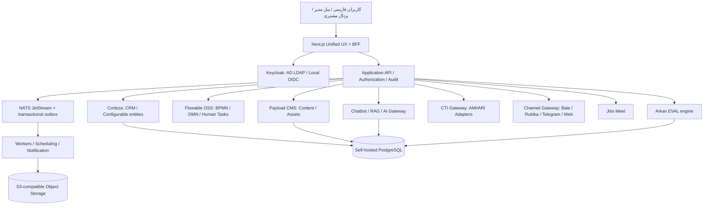

# سند نیازمندی‌های محصول (PRD) — پلتفرم یکپارچه رشد، فروش، بازاریابی و مدیریت محتوا

> **نام موقت محصول:** Arkan Growth OS (نام تجاری نهایی قابل تنظیم)  
> **شناسه:** PRD-AGOS-001 | **نسخه:** 1.0 | **وضعیت:** مبنای اجرا / نیازمند دروازه‌های اعتبارسنجی  
> **تاریخ مبنا:** ۱۴۰۵/۰۹/۰۵ — 2026-11-26  
> **زبان پیش‌فرض:** فارسی (`fa-IR`)؛ جهت پیش‌فرض RTL؛ انگلیسی قابل انتخاب  
> **محیط مقصد:** نصب کامل روی زیرساخت متعلق به بهره‌بردار (Self-hosted / On-premise)  
> **مخاطب:** مدیر محصول، معمار نرم‌افزار، ایجنت‌های کدنویس مبتنی بر Ruflo، تیم QA و مدیر زیرساخت  
> **وضعیت تصمیمات:** الزامات این سند الزام‌آورند؛ هر مورد «پژوهش/PoC» قبل از ادغام تولیدی باید با شواهد بسته شود.

---

## 0. دستور اجرایی برای ایجنت کدنویس — پیش از هر خط کد

**هدف:** ساخت یک محصول سازمانی یکپارچه، فارسی‌محور، توسعه‌پذیر و فاقد وابستگی به افزونه تجاری اجباری؛ نه کنار هم گذاشتن چند داشبورد نامرتبط.

1. این سند، تمام READMEها، ساختار و فایل‌های مرتبط مخازن مرجع، `SKILL.md` و `AGENTS.md` نسخه پین‌شده Ruflo را بخوان؛ سپس `docs/architecture/ADR-*.md`، مدل دامنه و برنامه مهاجرت را تولید کن.
2. ساختار پروژه را با **Ruflo** و skill رسمی آن آماده کن؛ همه تغییرات تولیدی باید دارای شناسه وظیفه، عامل اجرا، بازبینی مستقل، آزمایش، اسکن امنیت و گزارش اثر باشند. Ruflo **ابزار هماهنگی عامل‌های توسعه** است و **جای Flowable BPMN، صف پیام یا CTI runtime را نمی‌گیرد**.
3. ساخت کد تا زمان تکمیل **LIC-GATE-001** ممنوع است: سه مخزن `personal-branding-studio`، `arkan-eval` و `arkan-website-chatbot` فورک مخازن `siavash-smf` هستند و در درخت ریشه بررسی‌شده فایل `LICENSE` صریح مشاهده نشده است. در صورت نبود مجوز یا اجازه کافی، فقط از آن‌ها به‌عنوان **مرجع رفتار و نیازمندی** استفاده شود و پیاده‌سازی مستقل و پاک‌اتاق (clean-room) انجام شود؛ کپی‌کردن کد، پرامپت‌ها، فایل‌های رسانه‌ای، داده‌های آرکان و برند گاید ممنوع است. علامت «رایگان/متن‌باز» در README جانشین مجوز حقوقی نیست.
4. ابتدا یک PoC عمودی بساز: ورود با AD یا کاربر محلی → دریافت پیام بله یا تماس Issabel → ساخت Lead/Case → تسک کانبان → اجرای BPMN → اعلان → ثبت در داشبورد و ممیزی. **هیچ قابلیت P0 فقط به شکل mock، اسکرین‌شات یا صفحه خالی پذیرفته نیست.**
5. در محیط اصلی همه سرویس‌ها و داده‌ها روی سرورهای بهره‌بردار اجرا شوند. استفاده از سرویس ابری شخص ثالث فقط یک Connector اختیاری و صریحاً فعال‌شونده است؛ هیچ بخش اصلی نباید برای فعال شدن به Vercel، Supabase Cloud، OpenRouter، Claude subscription یا API تجاری وابسته باشد.
6. هر ماژول باید API مستند، مدل مجوز RBAC، رویداد دامنه، تست، راهنمای عملیات و کلیدهای تنظیمات مدیر داشته باشد. کلید محرمانه در رابط مرورگر/ریپازیتوری/لاگ نوشته نشود.

**Definition of Done کل محصول:** سناریوهای پذیرش §§ 18 تا 20 پاس شوند؛ هیچ مجوز اجباری پولی، تعارض مالکیت داده، شکاف RBAC یا وابستگی به شبکه خارجی برای عملکرد اصلی وجود نداشته باشد.

---

## 1. مسئله، چشم‌انداز و عامل‌های موفقیت

### 1.1 مسئله

فروش، بازاریابی، برندینگ، تولید محتوا، مکالمات مشتری، مرکز تماس و ارزیابی کیفیت هوش مصنوعی در ابزارهای جداگانه قرار دارند؛ داده مشتری و وظایف تکراری می‌شوند، تصویب‌ها قابل ردیابی نیستند، انتشار محتوا و پاسخ‌گویی چندکاناله به نیروی انسانی وابسته می‌شود و تنظیمات اساسی نیاز به تغییر کد دارد.

### 1.2 چشم‌انداز

«یک محیط کاری فارسی‌زبان و چابک که از کشف مشتری تا فروش، تولید محتوا، ارتباطات، رسیدگی به شکایت، ارزیابی AI و تحلیل بازگشت سرمایه را با گردش کار قابل‌طراحی مدیریت می‌کند.»

### 1.3 شاخص‌های موفقیت پیشنهادی (اهداف پذیرش، نه ارقام موجود)

| شناسه | شاخص | هدف اولیه و روش اندازه‌گیری |
|---|---|---|
| KPI-01 | پوشش فرایندهای فروش و بازاریابی | اجرای 100٪ سناریوهای بحرانی §18 بدون خروج از سامانه، به‌جز اقدام دستی موردنیاز API کانال |
| KPI-02 | قابلیت استفاده فارسی | 100٪ صفحات P0 با RTL، تاریخ شمسی و ورودی فارسی در مرورگرهای هدف بدون خطای بحرانی |
| KPI-03 | زمان ساخت وظیفه از رویداد ورودی | p95 کمتر از 5 ثانیه از ثبت رویداد معتبر تا ایجاد تسک، در بار آزمون تعریف‌شده |
| KPI-04 | عملکرد UI | p95 درخواست‌های تعاملی خواندنی کمتر از 500ms در محیط تست؛ Core Web Vitals مطابق بودجه §16 |
| KPI-05 | قابلیت اطمینان رویداد | عدم گم‌شدن رویداد پذیرفته‌شده؛ تحویل حداقل یک‌بار + مصرف idempotent |
| KPI-06 | قابلیت پیکربندی | 100٪ تنظیمات P0 مندرج در §13 از پنل مدیر، بدون ویرایش سورس |
| KPI-07 | استقلال لایسنس | صفر قابلیت P0 با الزام مجوز/اشتراک تجاری نرم‌افزاری |
| KPI-08 | ممیزی | 100٪ عملیات حساس دارای actor، زمان، موجودیت، تغییر و correlation ID |
| KPI-09 | تاب‌آوری کانال | خرابی یک شبکه اجتماعی یا PBX موجب توقف کانال‌ها یا فرایندهای دیگر نشود |
| KPI-10 | کیفیت AI | آستانه‌های EVAL برای پاسخ‌گویی و محتوای منتشرشونده با Golden Set مصوب کسب‌وکار قابل کنترل باشند |

### 1.4 نقش‌های کسب‌وکار

مدیرعامل/مدیر ارشد، مدیر فروش، کارشناس فروش، مدیر بازاریابی، مدیر برند، استراتژیست محتوا، کپی‌رایتر، طراح/تدوینگر، تأییدکننده حقوقی/برند، اپراتور مرکز تماس، سرپرست پشتیبانی، کارشناس پشتیبانی، تحلیلگر BI، مدیر AI/EVAL، مدیر فرایند، مدیر امنیت، مدیر سیستم، مشتری بیرونی/مخاطب.

---

## 2. ممیزی هدفمند مخازن مبنا و تصمیم بازاستفاده

**دامنه بررسی:** ساختار درخت Git، README، manifests و فایل‌های کلیدی انتخاب‌شده در شاخه اصلی و SHAهای زیر؛ این کار **ممیزی کامل خط‌به‌خط، تست اجرا یا ممیزی حقوقی نهایی نیست**. قبل از کار، ایجنت باید کل نسخه پین‌شده را در محیط کنترل‌شده اسکن و اجرا کند.

| مخزن / Commit SHA در زمان تدوین | آنچه واقعاً در مخزن مشاهده شد | تصمیم مهندسی / محدودیت |
|---|---|---|
| [`personal-branding-studio`](https://github.com/kayvanazarbarzin/personal-branding-studio) — `94affd916bbb9d931d7042bb75b897f617376ab1` | سرور HTTP پایتون `app/server.py`، HTML/JS بدون فریم‌ورک، هسته برند `brand/brand-core.md`، بانک ایده، ریلز، استوری، کاروسل، تحلیل اینستاگرام و ابزار ویدئو. محلی روی `127.0.0.1:7788` و متکی به CLI اشتراک Claude و در بعضی امکانات Gemini؛ انتشار اینستاگرام دستی و ویرایش ویدئو عمدتاً مک | **پورت مفهومی** به موتور محتوا و برند سازمانی؛ اجرای مستقیم سرور محلی و وابستگی به اشتراک Claude در محصول اصلی ممنوع. در صورت احراز مجوز، استخراج منطق مجاز؛ وگرنه بازنویسی مستقل |
| [`arkan-eval`](https://github.com/kayvanazarbarzin/arkan-eval) — `7e9c1bfe9a567daa1dc67e40aca9d2d6c6c63b82` | Next.js 14، TS، Supabase اختیاری، Golden Set، سنجش چهارگانه expectation/faithfulness/brand voice/safety، آزمون‌های قطعی، مدل هدف HTTP، اجرای CLI، داشبورد و هزینه. `src/lib/auth.ts` در نبود `EVAL_PASSWORD` دسترسی را باز می‌کند | طراحی موتور EVAL پایدار با RBAC، صف، تاریخچه و مدل‌های محلی؛ حذف auth آموزشی و تنظیمات باز؛ جداسازی داور از هدف و کالیبراسیون |
| [`arkan-website-chatbot`](https://github.com/kayvanazarbarzin/arkan-website-chatbot) — `4475fda274b40c49bbda15c51ab3b9d63c560079` | Next.js 14، RAG چندکاناله، Supabase، admin UI، کاربران با نقش‌های رتبه‌ای owner/admin/editor/operator/viewer، CRM شامل Lead/Company/Contact/Deal/Activities/Contracts/Campaigns/Reports، Telegram webhook و ویجت وب؛ `src/lib/rag/chat.ts` هسته کانال‌مستقل | **مبنای تحلیل دامنه و قراردادهای مهاجرت**؛ یکپارچه‌سازی با CRM مرجع، RBAC سطری/سطحی، افزودن Bale/Rubika/CTI، خودمیزبانی و حذف دامنه‌های hardcode |
| [`ruvnet/ruflo`](https://github.com/ruvnet/ruflo) — `48b04dce286a1df4af0411923821cf63399d7c8b` | `SKILL.md`، agent orchestration، hooks، حافظه، swarm، MCP، تست امنیتی و مستندات؛ مجوز MIT | مرجع به‌روز برای گردش کار توسعه. نصب نسخه و دستورها پس از بررسی سازگاری و قفل نسخه |
| [`kayvanazarbarzin/ruflo`](https://github.com/kayvanazarbarzin/ruflo) — `9576a1032b0749ac12d08fd9d05b86d4bee893b5` | فورک قدیمی‌تر از upstream؛ `SKILL.md`، `AGENTS.md` و package؛ وابستگی‌های alpha/نسخه‌های متفاوت با upstream؛ مجوز MIT | **مرجع اصلی موردنظر مالک**؛ ابتدا fork را با upstream مقایسه، وصله‌های امنیتی و تغییرات انتخابی را merge/test و SHA ابزار را pin کن؛ استفاده بی‌بررسی از fork قدیمی ممنوع |

### 2.1 بدهی فنی مشاهده‌شده که نباید کپی شود

- `arkan-eval/src/lib/auth.ts`: دسترسی آزاد اگر رمز محیطی تعریف نشده باشد؛ در محصول نهایی **fail-closed**.
- `arkan-website-chatbot/src/lib/auth.ts`: کلید نشست پیش‌فرض توسعه، session مبتنی بر HMAC اختصاصی، نشست سازگاری `legacy` بدون انقضا، نقش‌های سلسله‌مراتبی بدون مجوز دقیق؛ با **OIDC و authorization server-side** جایگزین شود.
- `arkan-website-chatbot/src/app/api/telegram/webhook/route.ts`: آدرس Vercel hardcoded، rate limit داخل حافظه یک پردازه، اعتبارسنجی webhook مشروط به وجود secret؛ با تنظیمات مدیر و rate-limit توزیع‌شده و secret اجباری اصلاح شود.
- `arkan-website-chatbot/src/lib/crm/reports.ts`: تجمیع ردیف‌های خام در Node؛ گزارش حجیم باید در SQL/Materialized View/OLAP انجام شود.
- `personal-branding-studio/docs/DEVELOPMENT.md`: قابلیت‌ها برای کاربر واحد محلی، فایل‌های JSON و subprocess طراحی شده‌اند؛ الگوی چندکاربره، صف، سهمیه‌بندی و sandbox لازم است.
- داده‌ها و پرامپت‌های مخصوص شرکت «آرکان» در مخازن **داده نمونه/مرجع آموزشی** هستند و نباید به‌صورت پیش‌فرض وارد داده واقعی سازمان شوند.

### 2.2 دروازه حقوقی الزامی — LIC-GATE-001

- وضعیت فورک، وجود LICENSE در تمام شاخه‌ها و سوابق، منشأ هر asset، dependency، فونت، رسانه، مدل، prompt و ابزار خارجی ثبت شود.
- از نویسنده بالادستی (`siavash-smf`) مجوز مکتوب سازگار با استفاده/تغییر/توزیع تجاری کد اخذ شود **یا** پیاده‌سازی مستقل انجام شود؛ صرف مالکیت فورک GitHub حق بازتوزیع ایجاد نمی‌کند.
- در `docs/compliance/SBOM.json` و `THIRD_PARTY_NOTICES.md` مجوز دقیق هر dependency و کد اقتباسی حفظ شود؛ CI هر dependency با مجوز ناشناخته/ناسازگار را مسدود کند.
- هسته محصول و افزونه‌های اجتناب‌ناپذیر از مجوزهای permissive (MIT/Apache-2.0/BSD یا مورد تأیید حقوقی) استفاده کنند. اجرای داخلی یک برنامه AGPL با الزام انتشار یکپارچه کد یکسان نیست، ولی برای حذف ریسک، کامپوننت AGPL اصلاح‌شده/توزیع‌شونده به‌صورت پیش‌فرض ممنوع است؛ استثنا با تأیید حقوقی.
- منشأ ابزار Ruflo: MIT؛ کد تولیدشده توسط عامل، مجوز مستقل از حقوق کد ورودی، مدل، dataset و dependency لازم دارد. رمزها/توکن‌ها به context ایجنت فرستاده نشوند.

---

## 3. معماری مصوب و مرزبندی مسئولیت‌ها

### 3.1 اصول معماری

- **Modular Monolith برای هسته محصول + سرویس‌های تخصصی جدا**؛ ابتدا از microservice بی‌دلیل پرهیز شود.
- رابط واحد Next.js/React/TypeScript و BFF؛ زبان فارسی و RBAC سراسری. از دو پنل موازی برای کاربر روزمره اجتناب شود.
- اصل **One Source of Truth**: داده authoritative فقط در یک محل؛ سایر بخش‌ها projection/index هستند.
- **Flowable OSS** مسئول BPMN 2.0 و human task؛ **Corteza** مسئول CRM low-code و موجودیت‌های سفارشی/تنظیمات مربوطه؛ **Payload CMS** برای محتوا و فایل‌های تحریریه؛ **Keycloak** برای هویت؛ **CTI Gateway** برای تلفن؛ **Channel Gateway** برای شبکه‌های اجتماعی؛ **EVAL service** برای ارزیابی؛ **Jitsi** برای جلسات؛ **Ruflo** صرفاً برای orchestration توسعه و در صورت تصمیم جداگانه آزمایش عوامل AI.
- در لایه برنامه، کد زیرسیستم‌ها به implementation موتورهای بیرونی وابسته نشود؛ پورت‌ها/آداپترها و قرارداد API نسخه‌دار تعریف شوند.



### 3.2 مالکیت داده‌ها (الزام ضدتکرار)

| دامنه | مالک قطعی | نحوه دسترسی دیگران |
|---|---|---|
| Lead, Account/Company, Contact, Deal, Sales Activity, Quote metadata | Corteza CRM یا adapter منتخب مبتنی بر آن | API نسخه‌دار + outbox؛ مهاجرت CRM آرکان با mapping و reconciliation |
| نسخه و محتوای صفحه، مقاله، دارایی خلاق، الگو، برندگاید | Payload CMS / Content Studio module | API/Events؛ رکورد لینک‌شده در CRM فقط reference |
| Process Definition, Process Instance, Human Task, Timer | Flowable OSS | Workflow Facade در API؛ برد کانبان فقط projection و فرمان کنترل‌شده |
| حساب کاربری، رمز، گروه، نشست و MFA | Keycloak خودمیزبان؛ federation با AD یا هویت محلی Keycloak | OIDC token + User Profile در برنامه؛ رمز در دیتابیس دامنه کپی نشود |
| Permission/Role/Policy/Scope کسب‌وکاری | Authorization service در برنامه | default deny در همه APIها؛ نگاشت گروه AD به role template |
| مکالمه/پیام/هویت کانالی/رسید ارسال | Channel Gateway + DB برنامه | لینک به contact از طریق identity resolution و رضایت |
| رویداد/ضبط/آمار تماس | CTI Gateway + DB/Storage | لینک به Contact, Case, Deal؛ فایل ضبط با URL امضاشده |
| مستندات RAG، embeddings، index و گفتگو AI | Knowledge + AI service | جداسازی tenant و سطح محرمانگی؛ منبع سند با ACL |
| Test Suite, Run, Judge, Score, Traces, Drift | EVAL service | داده خام و نتایج نسخه‌دار؛ نمای تجمیعی در داشبورد |
| تنظیمات اجرایی، Secret refs، Audit | Settings + Secrets service | مدیریت با مجوز مخصوص، نسخه‌بندی و ثبت تغییرات |

**قاعده اجباری:** رابطه بین `crm_contact_id`، `channel_identity_id` و `pbx_caller_id` از طریق جدول mapping با confidence/verification نگهداری شود؛ صرف تشابه شماره/نام موجب ادغام اتوماتیک غیرقابل‌برگشت نشود.

### 3.3 استک پیاده‌سازی پیشنهادی

| لایه | گزینه اصلی | نکته |
|---|---|---|
| Web/BFF | Next.js/React/TypeScript، Tailwind | نسخه LTS سازگار، pin و بررسی امنیت هنگام اجرا؛ RTL-first |
| Backend domain | TypeScript/Node.js به صورت modular monolith | REST/OpenAPI؛ Webhook Receiver؛ Zod؛ async workers |
| Data | PostgreSQL + pgvector | DB/schema جدا برای سرویس‌ها؛ migrations؛ index؛ backups |
| Cache/rate limiting | Valkey | بدون وابستگی به Redis دارای شروط مجوز جدید |
| Event bus | NATS JetStream + transactional outbox | at-least-once؛ idempotency؛ DLQ/replay |
| Asset storage | S3-compatible self-hosted با مجوز تأییدشده (نامزد: SeaweedFS) | لایسنس، اسکن آنتی‌ویروس و lifecycle حتماً بررسی شود |
| Identity | Keycloak + OIDC + LDAP/AD | هویت محلی خودمیزبان و AD در یک مسیر |
| BPM | Flowable OSS Engine | موتور/REST و UI طراحی BPMN سفارشی، بدون وابستگی به محصول تجاری |
| CRM low-code | Corteza | API façade؛ translation اختصاصی فارسی و PoC UI |
| CMS | Payload CMS | ترجمه فارسی، media و content collections |
| Meeting | Jitsi Meet self-hosted | ایجاد جلسه، JWT/secure room، لینک در CRM |
| AI inference | Local model gateway (مثلاً vLLM/Ollama در صورت تأیید license مدل) | provider abstraction؛ هیچ API ابری اجباری نیست |
| STT/TTS | موتورهای آفلاین دارای کیفیت قابل‌قبول فارسی | ارزیابی حقوق مدل و کیفیت فارسی پیش از انتخاب |
| Observability | OpenTelemetry، Prometheus و داشبورد مورد تأیید لایسنس | trace و metrics بدون خروج داده از شبکه |

**Corteza در MVP** باید در PoC میزان پوشش CRM و هزینه فارسی‌سازی را اثبات کند. اگر ادغام آن مانع جدی تجربه یکپارچه، توسعه یا مجوز شد، جایگزینی تنها از طریق ADR مستند و با حفظ قراردادهای CRM مجاز است؛ ساخت هم‌زمان دو CRM مستقل ممنوع.

---

## 4. برنامه محصول: دامنه و اولویت

| اولویت | تعریف | تصمیم |
|---|---|---|
| P0 | برای راه‌اندازی معتبر و زنجیره ارزش End-to-End الزامی | هویت و RBAC، CRM، کانبان، BPMN، تنظیمات مدیر، فارسی، CTI Asterisk، Bale/Rubika Bot، RAG/Chat، CMS، بازاریابی پایه، EVAL پایه، audit، پشتیبان |
| P1 | برای پوشش عملیاتی کامل تیم فروش/مارکتینگ در گسترش بعدی | پیش‌بینی فروش، attribution پیشرفته، A/B، اتوماسیون محتوا، انتشار هوشمند، Jitsi عمیق، تحلیل تماس، SEO، Brand Asset Management، گزارش مدیریت پیشرفته |
| P2 | توسعه انتخابی با تأیید | سایر PBXها، تولید ویدیو سنگین، live agent voice، کانال‌های جدید و marketplace افزونه |

P0 نباید تبدیل به «نمایشی» شود. P1 و P2 باید دارای interface و feature flag بوده و نبودشان استقرار P0 را خراب نکند.

---

## 5. نیازمندی‌های فروش و CRM (SALE)

| ID | اولویت | نیازمندی قابل تست |
|---|---|---|
| SALE-001 | P0 | Lead intake از سایت، چت‌بات، فرم، بله، روبیکا، تلفن، ثبت دستی و API؛ ذخیره منبع، campaign، UTM و consent |
| SALE-002 | P0 | شناسایی تکراری با شماره نرمال‌شده (`+98`، صفر ابتدایی)، ایمیل، سازمان و سیاست تأیید ادغام؛ merge audit/rollback |
| SALE-003 | P0 | Account/Contact و نمای 360 درجه شامل تعامل، پیام، تماس، معامله، تسک، قرارداد، رضایت و SLA |
| SALE-004 | P0 | Lead qualification و Lead scoring با قواعد UI، امتیاز AI پیشنهادی و قابلیت override انسان |
| SALE-005 | P0 | چند Pipeline قابل تنظیم؛ مراحل، احتمال، شروط انتقال، مالک، تیم، علت Lost، فعالیت اجباری و تاریخچه |
| SALE-006 | P0 | Deal Kanban با Drag & Drop بر اساس permission + guard BPM؛ فیلتر، جست‌وجو، WIP limit اختیاری |
| SALE-007 | P0 | Task، Appointment، Follow-up، Reminder، Delegation، Assignment، Priority، Due date، Attachment و Dependency |
| SALE-008 | P0 | Quote/Proposal/Contract با قالب، نسخه، فایل PDF، تأیید BPM، وضعیت ارسال/مشاهده/تأیید، تاریخ شمسی و کنترل دسترسی |
| SALE-009 | P0 | گزارش قیف، win/loss، سرعت مراحل، علت باخت، نرخ تبدیل، فعالیت کارشناسان و سررسیدها با سطح دسترسی |
| SALE-010 | P1 | Forecast، quota/target، territory، تیم، نرخ تحقق، cohort و انتساب درآمد به کمپین |
| SALE-011 | P1 | اتصال اختیاری ERP راهکاران فقط از طریق Integration API حسابرسی‌شده؛ read-only به‌صورت پیش‌فرض |
| SALE-012 | P0 | inbound/outbound email به صورت SMTP/IMAP محلی/سازمانی و template، unsubscribe و opt-in برای کمپین |

**قواعد:** تغییر وضعیت معامله باید event تولید کند؛ تعریف Pipeline از UI و versioning؛ گزارش‌ها از داده server-side و با scope مجوز؛ هیچ ارسال جمعی بدون رضایت/مجوز کانال.

## 6. بازاریابی، کمپین و رشد (MKT)

| ID | اولویت | نیازمندی |
|---|---|---|
| MKT-001 | P0 | Marketing Workspace: هدف، بازار هدف، پرسونا، بودجه، KPI، مالک کمپین و بازه زمانی |
| MKT-002 | P0 | Campaign/Channel/Touchpoint، UTM builder، لینک کوتاه self-hosted، فرم Lead Capture، صفحه فرود CMS |
| MKT-003 | P0 | Segment builder با قواعد ذخیره‌شونده (فیلد، فعالیت، consent، تاریخ، کانال) و preview تعداد مخاطبان مجاز |
| MKT-004 | P0 | تقویم مشترک کمپین و محتوا با نمای روز/هفته/ماه شمسی، کانبان و تقویم تحریریه |
| MKT-005 | P0 | Draft → Review → Legal/Brand approval → Schedule → Publish/Manual Export → Metrics؛ تمام انتقال‌ها BPM |
| MKT-006 | P0 | یکپارچه‌سازی بله/روبیکا برای پیام و بات در حدود API رسمی؛ گزارش delivery/failure و outbound opt-in |
| MKT-007 | P0 | برنامه انتشار با قابلیت native publish در کانال‌های تأییدشده و **manual handoff** در کانال فاقد مجوز API |
| MKT-008 | P1 | مدیریت تبلیغات، CAC، CPL، ROAS با داده واقعی واردشده/منابع API، برچسب کیفیت داده و attribution model |
| MKT-009 | P1 | A/B test عنوان/CTA/متن، baseline، گروه‌ها، نتیجه و قاعده توقف |
| MKT-010 | P1 | SEO/content audit: متا، schema، canonical، keyword mapping، internal linking و sitemap از CMS |
| MKT-011 | P1 | برنامه nurture چندمرحله‌ای بر اساس رویداد و ترجیح مخاطب؛ rate limit و frequency cap |
| MKT-012 | P0 | داشبورد جامع مدیریت فروش/بازاریابی با drilldown، فیلتر زمان/کانال/کمپین/تیم و export با RBAC |

**تعریف «پوشش کامل تیم»:** هر ایده، کمپین، تسک، تعامل، نسخه محتوا، تأیید، انتشار/خروجی دستی و KPI باید یک شناسه، مسئول و وضعیت قابل ردیابی داشته باشد. اتصال به پلتفرم‌هایی که API رسمی محدود دارند نمی‌تواند به انتشار تضمینی تعبیر شود.

---

## 7. استودیوی برند، تولید محتوا و کپی‌رایتینگ (CONTENT)

### 7.1 قابلیت‌های الزام‌آور

| ID | اولویت | نیازمندی و خروجی |
|---|---|---|
| CNT-001 | P0 | چند Brand/Business Unit با Brand Core نسخه‌دار: مخاطب، ارزش پیشنهادی، شخصیت، لحن، پیام کلیدی، Pillar، رنگ، لوگو، واژگان مجاز/ممنوع، CTA، الزام حقوقی |
| CNT-002 | P0 | Creative Brief: هدف، مخاطب، کانال، فرم محتوا، بودجه زمانی، محدودیت و منابع |
| CNT-003 | P0 | Idea Inbox: متن، لینک، فایل، صوت، دسته، برچسب، اولویت، owner، منبع؛ تشخیص تکراری و تبدیل ایده به تسک |
| CNT-004 | P0 | AI-assisted ideation با retrieval از Brand Core و اسناد مصوب؛ انسان خروجی را تأیید می‌کند |
| CNT-005 | P0 | تولید نسخه‌های متن: مقاله، لندینگ، ایمیل، کپشن، CTA، تیتر، سناریوی ویدئو، اسکریپت تماس، پاسخ اعتراض و کپی تبلیغ |
| CNT-006 | P0 | «برندگارد» که قبل از تأیید محتوا تناسب لحن، ادعاها، منابع، حق نشر و خط قرمزها را ارزیابی و دلایل را ذخیره کند |
| CNT-007 | P0 | Editor چندزبانه RTL/LTR، تاریخچه و diff، کامنت، mention، review، rollback، preview کانال و قالب |
| CNT-008 | P0 | Asset Library: فایل، تصویر، ویدئو، فونت دارای مجوز، metadata، مالکیت/usage-rights، اعتبار مجوز، tag، نسخه، نسبت تصویر |
| CNT-009 | P0 | Template Studio برای story/carousel/post/email/landing و خروجی استاندارد؛ نسبت تصویر و safe area هر کانال قابل تنظیم |
| CNT-010 | P0 | تقویم محتوایی، batch production، اتصال به کمپین/مخاطب، منشأ ایده و سنجه اثر |
| CNT-011 | P1 | ترجمه/بازنویسی، transcript، subtitle فارسی، teleprompter، تبدیل ویدئوی بلند به short، FFmpeg-worker self-hosted |
| CNT-012 | P1 | سازنده thumbnail/کاور با صف پردازش و sandbox؛ استفاده از مدل‌های local یا دستی |
| CNT-013 | P0 | سنجش اثربخشی محتوا: impression/click/lead/conversion در حدود داده قابل‌دسترسی کانال، provenance مشخص |
| CNT-014 | P0 | Template مدیریت انتشار در بله/روبیکا و اعلان تأیید دستی برای عملیات فاقد API |

### 7.2 قواعد محصول محتوا

- فایل‌های `brand-core.md` و اسناد استودیوی مرجع فقط **الگوی مفهومی** ساخت Brand Profile هستند؛ برای هر tenant/brand یک مجموعه رکورد ساختاریافته و نسخه‌دار ایجاد شود.
- AI نمی‌تواند آمار، نقل‌قول، رضایت مشتری یا ادعای محصول بدون منبع بسازد؛ تمام ادعاهای fact باید source reference داشته باشند.
- ترجمه کامل محتوای دارای کپی‌رایت فقط در حد حقوق مجاز، استفاده داخلی یا مجوز صریح؛ بازنشر مستقیم محتوای ثالث و bypass محدودیت شبکه‌ها ممنوع.
- ذخیره فایل‌های رسانه‌ای و rendering روی worker جدا؛ وب‌سرور نباید در درخواست HTTP رندر طولانی اجرا کند.
- انتخاب مدل، prompt، قالب و Brand Core باید از UI مدیر/مدیر برند و با RBAC و نسخه‌بندی ممکن باشد.

---

## 8. صندوق ورودی یکپارچه و کانال‌های ایرانی (CHANNEL)

### 8.1 قرارداد Connector

هر کانال باید `connect()`, `health()`, `verifyInbound()`, `receive()`, `sendText()`, `sendMedia()`, `listCapabilities()`, `refreshCredentials()`, `handleRateLimit()`, `disconnect()` و رویدادهای `message.received|sent|delivered|failed`, `identity.linked`, `channel.health.changed` را پشتیبانی کند. متدهای فاقد توانایی رسمی باید `UNSUPPORTED_CAPABILITY` بازگردانند، نه موفقیت ظاهری.

### 8.2 ماتریس کانال‌ها

| کانال | دامنه مورد انتظار | وضعیت/محدودیت قابل اتکا | P0 |
|---|---|---|---|
| Web chat/widget | گفت‌وگو، Lead، handoff، فایل مجاز، رونوشت، فرم | با استفاده از منطق بازطراحی‌شده Arkan و API داخلی | بله |
| Telegram Bot | پیام، webhook، مکالمه، quick reply | Bot API؛ مجوز bot نه دسترسی به تمام حساب‌های کاربران | بله |
| **بله (Bale)** | بازو، پیام ورودی/خروجی، webhook، media/interactive طبق API | مستندات رسمی https://docs.bale.ai/ ؛ API مبتنی بر Telegram Bot با تغییرات؛ انتشار در کانال باید جداگانه با مجوز bot/ادمین آزمایش شود | **بله** |
| **روبیکا (Rubika)** | بات، پیام ورودی/خروجی، webhook یا polling | مستندات رسمی https://rubika.ir/botapi ؛ `botapi.rubika.ir/v3/{token}/{method}`؛ امکانات «روبینو» یا حساب عادی خارج از تضمین Bot API | **بله** |
| Email | صندوق ورودی، ارسال، قالب، unsubscribe و threading | SMTP/IMAP سازمانی؛ DNS و deliverability جداگانه | بله |
| Social publishing beyond bots | انتشار مستقیم پست/استوری، گزارش شبکه | فقط در صورت دسترسی مجاز به API رسمی؛ در غیر این صورت export + ثبت انتشار دستی | P1 |

### 8.3 جزئیات حیاتی

- نگاشت شناسه `external_message_id` و `external_user_id` به `channel_account_id` و `conversation_id`؛ حذف duplicate با `(tenant,channel,account,external_id)`.
- هر Webhook ابتدا امضای قابل‌ارزیابی/secret و schema را بررسی، سپس payload را با کمترین تأخیر در صف ذخیره کند؛ پردازش AI بعد از پاسخ HTTP انجام شود.
- در Rubika اگر امضای ثابت‌شده‌ای توسط API ارائه نشود، از secret endpoint، TLS، allowlist مشروط، validation و mechanism ضدبازپخش استفاده شود؛ ادعای signature verification رسمی بدون مستند ممنوع.
- Chat Inbox شامل assign/reassign، internal note، canned replies، SLA، tag، merge conversation، takeover human/AI، رضایت و فیلتر role/team باشد.
- انتشار انبوه بدون consent و امکانات unsubscribe و سقف ارسال ممنوع؛ ریسک مسدودسازی حساب/شرایط استفاده کانال باید در پنل به مدیر نمایش داده شود.
- کلیدها و Tokenها در Secret Store رمزگذاری‌شده؛ مدیر فقط امکان ثبت/تعویض/تست/ابطال دارد، نه خواندن متن کامل کلید بعد از ذخیره.
- هر کانال جدول قابلیت (text/media/keyboard/webhook/polling/edit/delete/channel-post/statistics) و نسخه API خود را در پنل نمایش دهد؛ قابلیت تأییدنشده خاموش بماند.

---

## 9. ارتباط تلفنی چندمرکزی و مرکز تماس (CTI)

### 9.1 دامنه و قرارداد

Gateway باید قابلیت اتصال به چند instance مستقل Issabel/Asterisk با تنظیمات، سطح دسترسی، timezone، extension و trunk مجزا را داشته باشد. ادغام مستقیم کد CRM با AMI/ARI ممنوع؛ PBX adapter مستقل و ثبت قابل جست‌وجو لازم است.

| ID | اولویت | نیازمندی |
|---|---|---|
| CTI-001 | P0 | ثبت Connection برای چند PBX با نام، endpoint، پورت، TLS/VPN، روش auth، timeouts و status از UI مدیر |
| CTI-002 | P0 | Adapter مبتنی بر Asterisk AMI برای call events، queue events، agent state؛ ARI برای عملیات دارای مجوز و call-control نیازمند آن |
| CTI-003 | P0 | normalize CDR/CEL، جهت/مدت/شماره/صف/داخلی/call-id/uniqueid/linkedid؛ هم‌بستگی انتقال و تماس‌های چندبخشی |
| CTI-004 | P0 | Screen Pop در تماس ورودی و جست‌وجوی چند شماره، Contact و تاریخچه مکالمه با محدودیت RBAC |
| CTI-005 | P0 | Click-to-Call، call logging، missed call task و روتینگ به مسئول آخر در صورت موجود بودن اختیار PBX |
| CTI-006 | P0 | Auto Case و SLA روی شکایت و لینک recording با محدودیت دسترسی و سیاست retention |
| CTI-007 | P1 | قواعد صف/مهارت، callback، زمان‌بندی تماس، نظرسنجی پس از تماس و supervisor monitor با مجوز و پشتیبانی PBX |
| CTI-008 | P1 | رونویسی آفلاین فارسی، خلاصه تماس، sentiment/complaint intent، redaction PII و بازبینی انسانی |
| CTI-009 | P0 | health، reconnect/backoff، event dedupe، idempotent replay، ثبت error و پایش latency برای هر PBX |
| CTI-010 | P0 | driver interface برای PBXهای غیرAsterisk بدون تغییر CRM یا BPM؛ Asterisk اولویت و الزام نخست است |

### 9.2 امنیت تلفنی

- AMI/ARI از شبکه کاربر عمومی قابل دسترس نباشند؛ segmentation و IP allowlist، حساب read-only برای رویدادها و credential مجزا برای call control.
- سطح دسترسی ضبط تماس، شنود و انتقال تماس **مستقل و حساس** است؛ مدیر معمولی حق شنود ندارد. ثبت رضایت و مقررات محل استقرار لازم است.
- webhook یا event جعلی نباید Deal یا Case تولید کند؛ هر رویداد با `pbx_instance_id` و `event_id` ردیابی شود.

### 9.3 آزمون مرجع

دو PBX آزمایشی مستقل (Issabel/Asterisk)؛ تماس ورودی، انتقال بین داخلی، تماس از دست‌رفته، ضبط و قطع ارتباط موقت شبکه، بدون ایجاد duplicate و با حفظ ordering منطقی بررسی شود.

---

## 10. BPMN و مدیریت تسک/کانبان (BPM / TASK)

### 10.1 اصول

- Flowable OSS **موتور اجرایی یگانه** برای process instances و human tasks؛ task board برنامه، نمای یکپارچه از user tasks و وظایف مستقل است، نه موتور BPM دوم.
- هر workflow versioned با BPMN XML استاندارد؛ شروع با فرم، رویداد، API یا schedule؛ gateway، timer، escalation، SLA، reassignment، compensation و subprocess بسته به تعریف.
- موتورهای workflow داخلی Corteza فقط برای اتوماسیون سبک درون Corteza و نه فرایند اصلی دارای مالکیت Flowable استفاده شوند؛ loop و trigger دوطرفه ممنوع.
- فرم و قواعد assignment/versioning قابل تنظیم از UI «مدیر فرایند»؛ deploy نسخه جدید فقط با اعتبارسنجی schema، شبیه‌سازی، permission و تأیید.

### 10.2 برد کانبان

ستون‌های قابل تنظیم، Swimlane براساس تیم/کمپین/مشتری، Drag & Drop، WIP limits، priority، due date شمسی، checklist، attachment، subtasks، comments، mentions، SLA badge، dependency، filter/saved view، bulk ops کنترل‌شده، فعالیت زنده (SSE/WebSocket)، و گزارش lead/cycle time.

**قانون انتقال:** Drag & Drop فقط یک `RequestTransition(taskId, targetState, expectedVersion)` می‌فرستد؛ سرور با RBAC و guard مربوط به BPM آن را اعتبارسنجی می‌کند؛ در صورت رد شدن UI به وضعیت قطعی برگردد. تغییر مستقیم `status` در DB ممنوع.

### 10.3 فرایندهای مرجع P0

**BPM-LEAD-01 — لید تا جلسه**: `LeadCreated` → Dedup → LeadScore/Rules → Assign → Human Follow-up → Timeout escalation → Book meeting/Jitsi → Qualified/Disqualified → Deal.

**BPM-CONTENT-01 — محتوا تا انتشار**: Idea → Brief → Draft/AI suggestions → EVAL Brand & Safety → Copy Review → Legal/Brand Approval → Schedule → API Publish یا Manual Export → Evidence → Performance review.

**BPM-COMPLAINT-01 — شکایت چندکاناله**: Call/Message → Identify → Case → Severity/DMN → SLA Timer → Assign → Investigation → Supervisor → Customer response → Customer confirm/close → CSAT.

**BPM-QUOTE-01 — پیشنهاد تجاری**: Deal stage → Quote draft → Price policy/DMN → Manager approval → Contract version → Dispatch → Acceptance/Reject → Audit.

**BPM-AI-CHANGE-01 — انتشار Prompt/Model**: Proposed change → Eval golden set → regression/guardrail → AI owner approval → staged release → monitor → rollback on breach.

### 10.4 DMN و قانون تجاری

قواعد lead routing، سطح اولویت شکایت، سقف تخفیف، مسیر تأیید، SLA و برندگارد قابل تنظیم در UI هستند؛ برای قواعد نیازمند DMN از قابلیت OSS مطمئن و آزموده استفاده شود. UI هر تغییر را Draft/Validation/Publish/Rollback کند. اگر Designer متن‌باز کاملی آماده نبود، طراحی UI ساده سفارشی برای subset پشتیبانی‌شده در MVP و import/export BPMN/DMN لازم است؛ ادعای وابستگی به Flowable Design تجاری ممنوع.

---

## 11. چت‌بات، دانش سازمانی و هوش مصنوعی (AI / RAG)

| ID | اولویت | نیازمندی |
|---|---|---|
| AI-001 | P0 | هسته واحد channel-agnostic با API: `reply`, `streamReply`, `handoff`, `summarize`, `suggestNextAction` |
| AI-002 | P0 | Ingestion از CMS، PDF/DOCX/MD/HTML/CSV با اعتبارسنجی، OCR فقط در صورت نیاز و job مجزا |
| AI-003 | P0 | RAG با PostgreSQL+pgvector، hybrid retrieval، source attribution، نسخه سند، tenant ACL و ردیابی retrieval IDs |
| AI-004 | P0 | Prompt registry نسخه‌دار، مدل/embedding/provider config از UI و امکان rollback |
| AI-005 | P0 | Provider مستقل با حالت پیش‌فرض inference و embedding محلی؛ remote provider فقط با مجوز صریح مدیر |
| AI-006 | P0 | Guardrails: prompt injection controls، محدودسازی ابزار، PII masking، policy refusal، citations و no hallucinated claims |
| AI-007 | P0 | Lead capture و ایجاد Case/Task فقط از طریق Tools با RBAC و تأیید side effect؛ agent مستقیماً DB یا PBX را تغییر ندهد |
| AI-008 | P0 | Handoff به انسان با context و transcript، opt-out و توقف پاسخ AI در مکالمه تحویل‌شده |
| AI-009 | P1 | پیشنهاد کپی/کمپین/برند و تحلیل تماس با AI؛ Human-in-the-loop پیش از انتشار یا عملیات پرریسک |
| AI-010 | P0 | ثبت model version، token/cost estimate، duration، citations، safety flags و correlation ID هر پاسخ |

**حریم داده:** برای سازمان، مدل AI خارجی پیش‌فرض `disabled` است؛ هیچ سند مشتری، ضبط تماس یا داده شخصی به سرویس بیرونی ارسال نشود مگر تنظیم و مجوز جدا، رضایت و سیاست DLP.

---

## 12. موتور ارزیابی Arkan EVAL (EVAL)

| ID | اولویت | نیازمندی |
|---|---|---|
| EVL-001 | P0 | Golden Set قابل ورود/ویرایش از UI و JSON/CSV، نسخه، owner، دسته، expected behavior، failure signals و weights |
| EVL-002 | P0 | Target adapter برای local chatbot endpoint و سایر کانال‌ها (stub و live)، چندنوبتی، log زمان پاسخ و منابع |
| EVL-003 | P0 | چهار داور مستقل: Expectation، Faithfulness، Brand Voice، Safety به‌علاوه deterministic checks و rubric قابل تنظیم |
| EVL-004 | P0 | اجرای async با صف، pause/resume/cancel، retry جزئی، budget، run status و جلوگیری از run ناقص در HTTP |
| EVL-005 | P0 | Regression Gate در CI/CD و قبل از انتشار prompt/model/KB؛ شکست ایمنی یا افت از threshold مانع publish |
| EVL-006 | P0 | RAG diagnostics: پاسخ بی‌منبع، retrieval miss، stale source، hallucination، gap و root cause |
| EVL-007 | P0 | Human label و judge calibration؛ ثبت اختلاف داور/انسان، audit و بروزرسانی rubric نسخه‌دار |
| EVL-008 | P1 | Production sample evaluation، drift، cohort، کیفیت هر channel/team، token usage و dashboard |
| EVL-009 | P0 | داده ارزیابی tenant-scoped و دسترسی `eval.run|view|manage|approve`؛ هیچ حالت fail-open |

آستانه‌های اولیه باید از baseline واقعی PoC استخراج شوند؛ در سند عمداً «۹۰٪» به‌عنوان واقعیت فعلی یا معیار قطعی کیفیت ادعا نمی‌شود. پیشنهاد اولیه برای gate: **Safety بحرانی = صفر خطا**، سایر امتیازها طبق baseline مصوب و حداقل نمونه کافی، با حق توقف مدیر کیفیت.

---

## 13. پنل مدیر و تنظیمات قابل تغییر بدون تغییر کد (ADMIN)

پنل مدیر یک **Configuration Control Plane** است. هر تغییر شامل اعتبارسنجی، پیش‌نمایش، test connection، تاریخچه، تأیید در موارد حساس، apply/rollback و audit باید باشد.

| گروه تنظیمات | فیلدها و قابلیت‌های اجباری |
|---|---|
| هویت و دسترسی | Active Directory LDAP URL/LDAPS، bind account secret ref، base DN، group mapping، sync interval، local accounts، MFA policy، session TTL، role templates |
| سازمان | tenant/BU/branch، تیم‌ها، ساختار سازمانی، timezone، locale، روزهای کاری، تعطیلی، تقویم و currency |
| CRM | entity/field/layout، مراحل پایپ‌لاین، فرمول Lead score، assignment، duplicate rule، custom form و validation |
| Tasks/BPM | بردها، ستون‌ها، WIP، process definitions، DMN، forms، due dates، assignment، escalation، SLA، publish/rollback |
| محتوا و برند | Brand Core، پرسونا، templates، media rules، tags، version approval، legal checklist، calendar |
| کانال‌ها | Bale/Rubika/Telegram/email account، credential secret ref، webhook URL، capability matrix، mapping، rate limits، schedule، test send، disable |
| CTI | چند PBX، AMI/ARI، queue/extension، screen-pop، mapping، call events، recording retention، test call، reconnect policy |
| AI/EVAL | local model URL، embedding، prompt registry، KB index، rerank settings، safety thresholds، evaluator suite، token budget، feature flags |
| CMS | Collections/Fields/Localization، media storage، SEO settings، publishing roles، public routes |
| ویدئوکنفرانس | Jitsi URL، auth/JWT، room policy، recording options، retention و access |
| داده/پشتیبان | backup schedule/retention، encryption key reference، storage quotas، export/import status، disaster restore test |
| استقرار/عملیات | public base URL، hostname و reverse-proxy profile، health، log level، worker concurrency، rollout flags، SMTP، certificates، backup target |
| پایش | logs/metrics/traces، alert thresholds، provider health، queue backlog، SLA alerts، incident contact |

**محدودیت صریح:** تغییر OS firewall، پارتیشن دیسک، DNS عمومی، NAT یا Kubernetes admin از داخل پنل فقط به‌وسیله **deployment controller با دستورات allowlisted، تأیید دومرحله‌ای و دسترسی جداگانه** قابل اجراست؛ اپلیکیشن نباید از UI امکان اجرای arbitrary shell/SSH یا آپلود کد اجرایی فراهم کند. تنظیمات استقرار تغییر امن تنظیمات اپلیکیشن هستند، نه اختیار نامحدود مدیر سرور.

**سیستم تنظیمات:** `config_definition`(key,type,scope,validation,sensitivity,requires_restart), `config_value`(version,tenant,env,actor), `secret_reference`, `config_audit`, `feature_flag`؛ هر زیرسیستم namespace مختص خود دارد. secrets با KMS/secret store محلی؛ رمزنگاری at-rest و rotation الزامی.

---

## 14. احراز هویت، RBAC و تفکیک سیستم/زیرسیستم (SEC)

### 14.1 هویت

- حالت اول: **Keycloak با Federation به Microsoft Active Directory** از طریق LDAP/LDAPS؛ گروه‌ها به role assignment ترجمه شوند و مزیت SSO/OIDC فراهم شود.
- حالت دوم: **کاربر محلی در دیتابیس Keycloak خودمیزبان PostgreSQL** و تحت مدیریت UI همین محصول؛ حساب local برای AD outage و break-glass پیش‌بینی شود.
- Keycloak منبع واحد Authentication است؛ **RBAC دامنه در خود محصول** اجرا می‌شود. local user یعنی account در محصول مستقرشده روی سرور مشتری، نه الزام به سرویس ابری.
- حذف/غیرفعال‌سازی حساب در AD باید با sync/session revocation و دوره زمانی قابل‌تنظیم اعمال شود. MFA برای مدیر سیستم/امنیت اجباری.
- API با OAuth2/OIDC JWT validated (issuer/aud/key rotation)؛ account service-to-service با client credentials کم‌اختیار؛ deny by default.

### 14.2 ساختار مجوز

مجوز به‌صورت `module.resource.action` و scope (`global`, `tenant`, `business_unit`, `team`, `assigned`, `own`, `field`) تعریف شود. RBAC نقش‌محور است؛ **کنترل scope رکورد و field-level** نیز مستقل لازم است. نقش‌ها additive با explicit deny برای داده حساس؛ تصمیم نهایی server-side.

| سیستم / زیرسیستم | permission namespaces نمونه و الزام‌آور |
|---|---|
| `iam` | `iam.user.read/create/update/disable`, `iam.role.manage`, `iam.group.map`, `iam.session.revoke` |
| `admin` | `admin.settings.view/change/approve`, `admin.secrets.rotate`, `admin.integrations.manage`, `admin.deploy.request/approve`, `admin.audit.read` |
| `crm.leads` | `crm.lead.view/create/edit/assign/merge/delete/export` |
| `crm.accounts` | `crm.account.view/create/edit/merge/delete/export`, `crm.contact.*` |
| `crm.sales` | `crm.deal.view/create/edit/transition/approve/export`, `crm.quote.*`, `crm.contract.*` |
| `tasks` | `tasks.board.view/configure`, `tasks.task.view/create/edit/assign/transition/delete` |
| `bpm` | `bpm.definition.view/design/deploy/rollback`, `bpm.instance.start/view/cancel`, `bpm.task.claim/complete/delegate` |
| `marketing` | `marketing.campaign.view/create/edit/approve/publish`, `marketing.segment.manage`, `marketing.analytics.view` |
| `content` | `content.brand.view/manage`, `content.asset.view/upload/delete`, `content.draft.create/edit/review/approve/publish`, `content.template.manage` |
| `channels` | `channels.account.view/configure`, `channels.message.view/send/delete`, `channels.broadcast.approve`, `channels.inbox.assign` |
| `cti` | `cti.call.view/dial/transfer`, `cti.recording.view/download`, `cti.supervise.monitor`, `cti.connection.configure` |
| `support` | `support.case.view/create/assign/escalate/close`, `support.sla.manage` |
| `ai` | `ai.chat.use`, `ai.prompt.view/edit/publish`, `ai.model.configure`, `ai.knowledge.ingest/view/delete`, `ai.tool.execute` |
| `eval` | `eval.suite.view/edit`, `eval.run.start/view/cancel`, `eval.rubric.manage`, `eval.release.approve` |
| `analytics` | `analytics.dashboard.view/configure`, `analytics.export`, `analytics.financial.view` |
| `meetings` | `meeting.room.create/join/manage/record`, `meeting.recording.view` |

### 14.3 نقش‌های پایه (Template؛ قابل ویرایش)

| نقش | دسترسی پیش‌فرض (محدود به سازمان/تیم مربوط) |
|---|---|
| `super_admin` | مدیریت نصب، tenant و مجوز؛ دسترسی داده حساس فقط با policy و audit |
| `security_admin` | IAM/RBAC/audit/integrations security؛ بدون حق فروش یا شنود خودکار |
| `system_admin` | configuration/deployment health و integrations؛ دسترسی به اطلاعات مشتری محدود |
| `process_admin` | طراحی/انتشار BPMN/DMN و پیکربندی تسک، نه دسترسی فراگیر قراردادها |
| `sales_manager` | تیم فروش، pipeline، approvals، reports و assignment؛ export حساس به policy |
| `sales_agent` | leads/deals/todos خود یا تیم مجاز و تماس؛ عدم مدیریت user/secret |
| `marketing_manager` | campaigns/segments/content calendar/approvals و reports |
| `content_creator` | create/edit draft، asset upload و preview؛ بدون publish بدون approval |
| `brand_approver` | review/approve brand، content و copyright checklist |
| `support_supervisor` | case/SLA/team، recordings مجاز و escalation؛ monitor با مجوز جدا |
| `support_agent` | تعاملات/Caseهای تخصیص‌یافته و پاسخ در inbox |
| `cti_operator` | call pop، click-to-call و وضعیت صف خود؛ ضبط فقط با مجوز جدا |
| `ai_admin` | models/KB/prompts/EVAL config و metrics؛ بدون اختیار انتشار محتوا به نام کاربران |
| `analyst` | dashboards و داده تجمیعی مجاز؛ export PII ممنوع مگر grant جدا |
| `viewer` | مشاهده حداقلی، بدون تغییر |
| `customer_portal` | مشاهده پرونده‌ها/قراردادهای متعلق به خود فقط |

### 14.4 الزامات آزمون دسترسی

- تمام endpointها، RSC/server actions، WebSocket/SSE subscriptions، فایل‌ها و background jobs enforcement یکسان دارند.
- اپراتور A نباید Case، ضبط یا تماس اپراتور B خارج از scope را با تغییر URL/ID ببیند.
- تغییر role/permission در کمتر از 60 ثانیه در نشست فعال اعمال شود (TTL/invalidations).
- Export، bulk operations، اتوماسیون AI و event consumer در scope نقش caller/service account اجرا شوند؛ privilege escalation ممنوع.
- هر تغییر RBAC و تنظیم حساس باید audit immutable و حداقل dual-approval برای تغییرات critical داشته باشد.

---

## 15. مدل داده، API و قرارداد رویداد

### 15.1 موجودیت‌های اصلی

`Tenant`, `BusinessUnit`, `Team`, `UserProfile`, `Role`, `Permission`, `RoleBinding`, `ScopePolicy`, `AuditEvent`, `Setting`, `SecretRef`, `FeatureFlag`;
`Lead`, `Account`, `Contact`, `ContactIdentity`, `Deal`, `Pipeline`, `Stage`, `Activity`, `Quote`, `Contract`, `Case`, `SLAPolicy`;
`Campaign`, `Segment`, `Touchpoint`, `UTM`, `MarketingAttribution`, `Brand`, `BrandCoreVersion`, `CreativeBrief`, `Idea`, `ContentDraft`, `ContentVersion`, `Asset`, `EditorialCalendarItem`, `Publication`;
`ChannelAccount`, `Conversation`, `Message`, `DeliveryReceipt`, `ConsentRecord`, `CTIConnection`, `Call`, `CallLeg`, `RecordingRef`, `AgentStatus`;
`WorkflowDefinitionRef`, `WorkflowInstanceRef`, `HumanTaskProjection`, `TaskBoard`, `TaskColumn`, `TaskTransition`, `AIModel`, `PromptVersion`, `KnowledgeDocument`, `KnowledgeChunk`, `EvalSuite`, `EvalRun`, `EvalCaseResult`.

### 15.2 نمونه قرارداد API

```http
POST   /api/v1/leads
GET    /api/v1/contacts/{id}/timeline
POST   /api/v1/deals/{id}/transitions
GET    /api/v1/tasks/boards/{boardId}
POST   /api/v1/tasks/{id}/transition
POST   /api/v1/workflows/{key}/start
POST   /api/v1/workflows/tasks/{id}/complete
POST   /api/v1/channels/accounts/{id}/test
POST   /api/v1/channels/{provider}/webhook/{accountAlias}
POST   /api/v1/cti/connections/{id}/test
GET    /api/v1/cti/calls/{id}
POST   /api/v1/content/{id}/submit-for-review
POST   /api/v1/eval/runs
GET    /api/v1/admin/settings
PUT    /api/v1/admin/settings/{key}
GET    /api/v1/audit/events
```

تمام درخواست‌های تغییر باید `Idempotency-Key` (در موارد لازم) و `X-Correlation-ID` را پشتیبانی کنند. فیلترها، صفحه‌بندی cursor، ترتیب، error codeهای نسخه‌دار، API schema و auth در OpenAPI تعریف شود. Webhookهای بیرونی شامل tenant/account route امن باشند.

### 15.3 رویداد استاندارد

```json
{
  "event_id": "uuid",
  "event_type": "lead.created.v1",
  "schema_version": 1,
  "tenant_id": "uuid",
  "aggregate_id": "uuid",
  "aggregate_version": 1,
  "occurred_at": "2026-11-26T12:00:00Z",
  "correlation_id": "uuid",
  "causation_id": "uuid",
  "actor": {"type": "user|service", "id": "uuid"},
  "payload": {"source": "bale", "campaign_id": null}
}
```

**الزامات:** Outbox در transaction تغییر دامنه، Inbox de-dup، قابلیت replay و dead letter، schema compatibility، retry exponential با jitter و alarm؛ no direct cross-service DB writes. تمامی timestampهای DB به UTC و تاریخ نمایشی به تقویم شمسی تبدیل شود.

---

## 16. کیفیت غیرعملکردی (NFR)، فارسی و زیرساخت

| ID | دسته | معیار پذیرش پیشنهادی |
|---|---|---|
| NFR-001 | فارسی | `fa-IR` پیش‌فرض، RTL سراسری، حروف «ی/ک» فارسی، نیم‌فاصله، فونت مجاز Vazirmatn، ورودی ترکیبی فارسی/انگلیسی |
| NFR-002 | تاریخ | ذخیره UTC/Gregorian استاندارد؛ نمایش/ورودی جلالی و تبدیل دوطرفه در فیلتر، فرم، تقویم، SLA و export؛ DST تست شود |
| NFR-003 | چندزبانه | i18n resource bundle با fallback، فارسی و انگلیسی، هر tenant/user قابل انتخاب، ترجمه label/form/error/template از UI |
| NFR-004 | کارایی | 200 کاربر هم‌زمان و 50 req/s بار ترکیبی PoC: API read p95 <500ms، write p95 <1000ms به‌جز external APIs و render؛ مقدار سرور گزارش شود |
| NFR-005 | UI | LCP p75 <2.5s، INP p75 <200ms، CLS p75 <0.1 در صفحات منتخب و شبکه آزمایشی مشخص |
| NFR-006 | availability | هدف 99.9٪ ماهانه برای هسته؛ خرابی خارجی کانال از SLO داخلی جدا گزارش شود |
| NFR-007 | بازیابی | هدف RPO ≤ 15 دقیقه و RTO ≤ 2 ساعت برای اجزای P0، منوط به معماری backup و آزمون restore |
| NFR-008 | امنیت | TLS، MFA حساس، secret rotation، least privilege، rate limit، CSRF، SSRF guard، upload scanning، SBOM، dependency scan |
| NFR-009 | حریم | consent، retention configurable، حذف/ناشناس‌سازی، export داده فرد، رمزگذاری ضبط/PII، ماسک لاگ |
| NFR-010 | کاربری | WCAG 2.2 AA برای بخش‌های اصلی، ناوبری کیبورد، کنتراست، focus و screen reader مناسب RTL |
| NFR-011 | عملیات | health/liveness/readiness، trace، metrics، alert، dashboard، backup، restore و runbook؛ آزمون قطع PBX/کانال |
| NFR-012 | استقلال | پس از ساخت imageها، startup و عملکرد P0 در شبکه بسته (air-gapped) به جز تبادل لازم با کانال/PBX بیرونی |

**مهم:** دسترسی بله/روبیکا به اینترنت ذاتاً لازم است؛ شرط self-hosted به معنی میزبانی کد، مدل، پایگاه داده و داده سازمانی روی سرور خود است، نه کارکرد شبکه خارجی در حالت قطع اینترنت.

### 16.1 طرح استقرار

- محیط‌های `dev`, `stage`, `prod` کاملاً جدا با Secret، DB، Storage و دامنه جدا.
- Docker Compose نسخه‌دار برای PoC و نصب تک‌سرویسی؛ برای تولید خوشه‌ای، manifests/Helm جدا در صورت نیاز. pin digest تصویرها؛ عدم استفاده `latest`.
- سرویس‌ها: reverse proxy + Web/BFF + API/Workers + PostgreSQL + Valkey + NATS JetStream + Corteza + Flowable + Payload + Keycloak + Jitsi + CTI + Channels + AI Gateway + inference + EVAL + object storage + observability.
- همگی پشت segmentation و داخلی باشند؛ تنها ingressهای لازم 443 و media ports Jitsi/خروجی API کانال باز شوند. PBX AMI/ARI فقط از VLAN/شبکه محدود مجاز.
- DB مستقل/role محدود برای هر سرویس؛ اتصال admin مشترک ممنوع؛ schema migration با rollback و snapshot.
- backup رمزنگاری‌شده PostgreSQL، object storage، config، BPM definitions و Keycloak realm؛ بازیابی end-to-end در محیط مجزا آزمایش شود.

---

## 17. سناریوهای سرتاسری کسب‌وکار و قراردادهای BPM

### E2E-01: لید از بله تا فروش

1. مخاطب با بات بله گفت‌وگو می‌کند؛ پیام با webhook معتبر و بدون تکرار وارد `Conversation` می‌شود.
2. چت‌بات با منبع معتبر پاسخ می‌دهد، رضایت می‌گیرد و Lead می‌سازد.
3. Lead در CRM با source=`bale` ثبت، dedupe و score می‌شود.
4. Flowable فرایند `BPM-LEAD-01` را شروع می‌کند؛ تسک روی کانبان فروش قرار می‌گیرد.
5. کارشناس پیگیری می‌کند، جلسه Jitsi/حضوری تنظیم می‌کند و مرحله Deal تغییر می‌کند.
6. داشبورد attribution، زمان پاسخ، هزینه/کیفیت AI و تبدیل را نمایش می‌دهد.

### E2E-02: تماس تلفنی و شکایت

1. Issabel تماس ورودی را اعلام می‌کند؛ CTI caller را با confidence قابل‌مشاهده شناسایی می‌کند.
2. Screen Pop فقط اطلاعات مجاز contact را نشان می‌دهد.
3. اپراتور «ثبت شکایت» را می‌زند؛ Case + transcript/recording reference با رضایت ثبت می‌شود.
4. BPM severity/SLA را طبق DMN تعیین، تسک را به صف پشتیبانی اختصاص و timer می‌سازد.
5. با عدم رسیدگی در مهلت مقرر، escalation و اعلان رخ می‌دهد.
6. سرپرست پاسخ را تأیید، Case بسته و CSAT در کانال مجاز ارسال می‌شود.

### E2E-03: ایده تا انتشار در روبیکا

1. ایده از بانک ایده به Creative Brief و Brand Core مرتبط می‌شود.
2. AI کپی و تصویر پیشنهادی تولید؛ EVAL کیفیت/ایمنی/ادعا را می‌سنجد.
3. نویسنده و مدیر برند نسخه را تأیید می‌کنند؛ BPM مسیر انتشار را اجرا می‌کند.
4. Channel Adapter اگر publish رسمی مجاز دارد ارسال می‌کند؛ وگرنه export و تسک «انتشار دستی» همراه لینک/مدرک ایجاد می‌شود.
5. رسید یا evidence و metrics منبع‌دار ثبت می‌شوند؛ هیچ success ساختگی ثبت نشود.

### E2E-04: تغییر مدل AI

تغییر Prompt/Model از UI → نسخه جدید → اجرای Golden Set در صف → گزارش EVAL → تأیید صاحب کیفیت → انتشار مرحله‌ای → پایش → rollback خودکار/دستی در شکست گاردریل.

### E2E-05: ورود مدیر و مدیریت چند زیرسیستم

مدیر با AD یا کاربر local Keycloak وارد می‌شود → نقش‌ها/Scope اعمال می‌شوند → تنظیم اتصال PBX و بله را با test connection تغییر می‌دهد → تغییر نسخه‌دار/ممیزی می‌شود → کارشناس فروش هیچ دسترسی به Secret، نقش‌ها یا داده خارج از تیم ندارد.

---

## 18. معیارهای پذیرش BDD (الزام برای QA و ایجنت)

| ID | Given / When / Then — تعریف آزمون |
|---|---|
| AT-01 | Given کاربر `sales_agent` در تیم A؛ When نشانی Lead تیم B را مستقیم درخواست کند؛ Then `403` و audit، بدون نشت داده |
| AT-02 | Given AD در دسترس نیست؛ When مدیر break-glass محلی MFAدار وارد شود؛ Then تنظیمات حیاتی در scope مجاز در دسترس و رویداد ثبت شود |
| AT-03 | Given دو webhook تکراری Bale با external_id برابر؛ When موازی پردازش شوند؛ Then فقط یک پیام و یک event downstream ایجاد شود |
| AT-04 | Given Rubika bot دارای قابلیت message؛ When پیام ارسال شود؛ Then receipt واقعی ذخیره شود؛ وقتی مجوز انتشار پست وجود ندارد system حالت manual را نشان دهد |
| AT-05 | Given PBX-1 و PBX-2 فعال؛ When تماس هم‌زمان وارد شود؛ Then رکورد هر تماس با tenant/instance مجزا و بدون collision ساخته شود |
| AT-06 | Given کارشناس تسک محتوایی در «در انتظار تأیید»؛ When آن را به «منتشر شد» Drag کند؛ Then موتور BPM انتقال غیرمجاز را رد و UI rollback کند |
| AT-07 | Given یک فرایند شکایت با SLA یک دقیقه در آزمایش؛ When زمان تمام شود؛ Then escalation یک‌بار ایجاد و مدیر مطلع شود |
| AT-08 | Given حساب مدیر مارکتینگ؛ When API تنظیم secret PBX را فراخوانی کند؛ Then دسترسی رد شود حتی اگر UI پنهان‌سازی خطا داشته باشد |
| AT-09 | Given سند RAG طبقه‌بندی‌شده برای تیم B؛ When کاربر تیم A سؤال مرتبط بپرسد؛ Then آن سند retrieve نشود و هیچ citation/اطلاعاتی نشت نکند |
| AT-10 | Given Eval runner بدون credential؛ When endpoint اجرا فراخوانی شود؛ Then `401/403` و هیچ run آغاز نشود |
| AT-11 | Given متن فارسی با ارقام و لینک انگلیسی؛ When در کانبان، تقویم، PDF و پیام ظاهر شود؛ Then ترتیب بصری و تاریخ شمسی درست باشد |
| AT-12 | Given شبکه خارجی قطع؛ When کاربر مدیریت CRM، محتوای داخلی، BPM و EVAL مدل محلی را اجرا کند؛ Then عملیات داخلی برقرار و کانال خارجی با queued/failure شفاف مشخص شود |
| AT-13 | Given worker حین انتشار پیام متوقف شود؛ When مجدد بالا آید؛ Then outbox replay و dedupe باعث حداکثر یک side effect منطقی شود |
| AT-14 | Given تنظیمات کانال از UI عوض شود؛ When test connection شکست بخورد؛ Then نسخه عملیاتی قبلی باقی و rollback/audit ثبت شود |
| AT-15 | Given یک کمپین کامل؛ When مدیر گزارش ROI را باز کند؛ Then CPL/Conversion/Attribution از داده واقعی و provenance، با نمایش موارد unknown محاسبه شود |
| AT-16 | Given دو نسخه content؛ When approver انتشار را رد کند؛ Then تاریخچه، علت و تسک اصلاح حفظ شود و انتشار انجام نشود |
| AT-17 | Given تغییر نقش کاربر در AD؛ When sync اجرا شود؛ Then scope جدید در API و queue در حد TTL توافق‌شده اعمال شود |
| AT-18 | Given دورزدن درخواست از مرورگر با ID دلخواه؛ When download recording غیرمجاز ارسال شود؛ Then file URL امضاشده تولید نشود |
| AT-19 | Given پشتیبان کامل؛ When استقرار در محیط مجزا restore شود؛ Then داده CRM، workflow، فایل، SSO و config سازگار و قابل کار باشد |
| AT-20 | Given dependency با مجوز ناشناخته؛ When CI build اجرا شود؛ Then release gate متوقف و گزارش SBOM ایجاد شود |

برای هر آزمون: تست API + UI + integration و log یا trace به‌عنوان evidence ذخیره شود. `PASS` بدون اجرای تست واقعی پذیرفته نیست.

---

## 19. برنامه فازبندی و وابستگی‌ها

| فاز | خروجی قابل تحویل | شرط پایان |
|---|---|---|
| F0 — Discovery / Compliance | اسکن دقیق پنج مخزن، license decision، ADR، UX wireframe، threat model، API contracts، baseline عملکرد | LIC-GATE-001 بسته، source SHA ثبت، scope P0 freeze |
| F1 — Platform Foundation | Monorepo، CI/CD، Ruflo harness، PostgreSQL، Keycloak/AD/local، RBAC، audit، config control plane، Persian design system | AT-01,02,08,11,17 و اسکن امنیت |
| F2 — CRM + Kanban + BPM | Corteza adapter و migration CRM آرکان، Flowable OSS، task board، Lead/Deal/Case، فرآیندهای Lead/Complaint/Content | فرایند بدون mock با transition guards |
| F3 — Channels + CTI | Web/Telegram/Bale/Rubika gateways، 2×Asterisk، Inbox، screen pop، SLA، recording ref | AT-03,04,05,07,13,18 |
| F4 — Content + Campaign + AI | Payload، Brand Core، Content Studio، تقویم، campaign، RAG محلی، publish manual/automated با capability flags | AT-09,12,15,16 |
| F5 — EVAL + Production Hardening | Golden Sets، LLM judges، CI gate، تست بار، restore، monitoring و runbooks | AT-10,14,19,20 و KPIهای §1 |
| F6 — Expansion | Forecast، SEO عمیق، attribution، transcription، Jitsi advanced، additional PBX/social adapters | پذیرش جداگانه P1/P2 |

**مسیر بحرانی:** حقوق بازاستفاده و مدل داده → Identity/RBAC → قرارداد CRM/Task/BPM → Event integration → Channel/CTI → Content/AI → EVAL/Hardening. توسعه هم‌زمان با interfaces ثابت مجاز است؛ تغییر بدون ADR ممنوع.

---

## 20. قرارداد اجرای Ruflo برای ایجنت‌های برنامه‌نویس (DEV-RUFLO)

### 20.1 قانون استفاده از fork

- مخزن مرجع شما: `https://github.com/kayvanazarbarzin/ruflo` و skill در `SKILL.md`؛ upstream: `https://github.com/ruvnet/ruflo`.
- فورک بررسی‌شده به‌روز نیست (وابستگی‌های alpha در مقابل نسخه‌های پایدارتر upstream). پیش از آغاز، fork reconciliation، dependency review، security tests و ثبت SHA انجام شود. **هیچ installer از شاخه `main` متغیر را بدون Pin اجرا نکن.**
- ایجنت هر تغییر محصول را با Ruflo orchestration و skill Ruflo انجام دهد، اما تک‌تسک‌های کوچک با عامل منفرد زیر همان audit harness مجازند؛ overhead غیرضروری تحمیل نشود.
- تنها CLIهای تأییدشده در `SKILL.md` در لحظه بررسی عبارت‌اند از `npx ruflo init`, `npx ruflo doctor --fix`, `npx ruflo discover-plugins`, `npx ruflo mcp list`. قبل از اجرای `--fix`، diff تغییرات خودکار بررسی شود؛ سایر فرمان‌ها ابتدا با `--help` و نسخه pin‌شده اعتبارسنجی شوند.

### 20.2 Bootstrap (در محیط توسعه، نه محیط production)

```bash
# ابتدا نسخه/Commit فورک و upstream را ثبت و تفاوت‌ها را بازبینی کن.
git clone https://github.com/kayvanazarbarzin/ruflo.git .vendor/ruflo
# SHA تأییدشده در lockfile داخلی پروژه ثبت شود.
# روش نصب skill از فورک باید با نسخه tools skills.sh بررسی شود؛
# در صورت پشتیبانی، از مسیر/commit pin‌شده نصب و SKILL.md کنترل شود.

# Ruflo CLI نسخه تأییدشده و pin‌شده را از registry یا mirror داخلی نصب کن.
# دستورهای نمونه پس از تطبیق نسخه با SKILL.md:
npx ruflo init
npx ruflo doctor
npx ruflo discover-plugins
npx ruflo mcp list
```

`npx ruflo doctor --fix` تنها در workspace توسعه، پس از اخذ diff و تأیید مجاز است. وابستگی به سرویس‌های LLM خارجی در زمان کدنویسی ممکن است وجود داشته باشد؛ شرط self-hosted مربوط به **محصول عملیاتی** است، نه ابزار اختیاری توسعه. بااین‌حال secrets و داده واقعی به agent provider ارسال نشوند.

### 20.3 نقش‌های توسعه و deliverable هر تغییر

| Agent role | مسئولیت | مدرک اجباری |
|---|---|---|
| Product Analyst | تبدیل IDهای PRD به stories و edge cases | `requirements-traceability.md` |
| Architect | ADR، مرزبندی داده، versioning و event contracts | نمودار و ADR |
| Backend Engineer | API/domain/async workers و migrations | OpenAPI، تست unit/integration |
| Frontend Engineer | UI فارسی، Kanban، accessibility | RTL screenshots و E2E |
| Integration Engineer | Channel/PBX/Corteza/Flowable/Keycloak adapters | Contract tests، replay fixtures |
| AI/EVAL Engineer | RAG، prompt، evaluator، guardrails | Golden set، trace و eval report |
| Security Reviewer | Threat model، RBAC، CVE، secret audit | `security-report.md` |
| QA/Performance | تست BDD، load، chaos، restore | `acceptance-evidence/` |
| Release Manager | SBOM، changelog، migration و rollback | release manifest و runbook |

### 20.4 سیاست تغییر کد

هر PR باید: `requirement_ids`, `source_refs`, `ADR_if_any`, `test_results`, `security_scan`, `license_diff`, `migration_plan`, `rollback_plan`, `perf_impact`, `screenshot_RTL_if_UI`, `Ruflo_run_trace` داشته باشد. Reviewer مستقل نباید همان عامل نویسنده کد باشد. merge روی protected branch پس از همه gateها؛ خطاها قبل از ادامه گزارش شوند. برای ایجنت استفاده از ابزار `shell` روی production، تغییر RBAC و خواندن secrets بدون approvals ممنوع.

### 20.5 ساختار پیشنهادی Monorepo

```text
arkan-growth-os/
  AGENTS.md                  # دستور ریشه ایجنت‌ها + ارجاع به PRD/Ruflo
  docs/
    PRD.md
    architecture/ADR-*.md
    compliance/{THIRD_PARTY_NOTICES.md,SBOM.json}
    api/openapi.yaml
    runbooks/
    acceptance-evidence/
  apps/
    web/                     # Next.js unified RTL UX
    worker/                  # jobs, scheduled tasks
  services/
    crm-adapter/
    workflow-facade/
    channel-gateway/
    cti-gateway/
    ai-gateway/
    eval-service/
  packages/
    authz/                   # RBAC + scope enforcement
    contracts/               # API/events/types
    ui/                      # فارسی/RTL design system
    i18n/
    observability/
    settings/
    test-kit/
  infra/
    compose/
    keycloak/
    corteza/
    flowable/
    payload/
    jitsi/
    monitoring/
  database/
    migrations/
    seed/
  workflows/
    bpmns/
    dmns/
  integrations/
    bale/
    rubika/
    telegram/
    asterisk/
  tests/
    contract/
    integration/
    e2e/
    load/
    security/
  .github/workflows/
```

**ملاحظه:** این ساختار پیشنهاد است؛ ایجنت می‌تواند ساختار را با ADR اصلاح کند اما مرزبندی ownership و traceability را نقض نکند.

---

## 21. ریسک‌ها و تصمیم‌های باز (Risk Register)

| ID | ریسک | درجه | اقدام قطعی |
|---|---|---|---|
| R-01 | نبود مجوز بازاستفاده صریح در سه فورک آموزشی | بحرانی | LIC-GATE-001؛ مجوز مکتوب یا clean-room |
| R-02 | فورک Ruflo قدیمی و وابستگی‌های alpha | بالا | sync/review + dependency pin + security scan |
| R-03 | فارسی و RTL ناقص Corteza | بالا | PoC کامل، translation package `fa-IR` و UI یکپارچه Next.js |
| R-04 | افزونه/Designer تجاری Flowable در برابر Engine OSS | بالا | استفاده از Flowable OSS Engine و UI مدل‌سازی خودی/متن‌باز بررسی‌شده |
| R-05 | مجوز و محدودیت API روبیکا/بله برای ارسال/انتشار | بالا | فقط API رسمی؛ capability flags؛ manual fallback |
| R-06 | تکرار Contact/Deal در Arkan و Corteza | بالا | authoritative data map، migration + reconciliation |
| R-07 | race condition در webhook/AMI و duplicate تسک | بالا | inbox/outbox idempotent، unique keys، replay tests |
| R-08 | نشت اطلاعات با نقش ساده یا مدل AI | بحرانی | RBAC+scope server-side، ACL retrieval، prompt guard، pentest |
| R-09 | وابستگی AI به اشتراک Claude/Gemini/OpenRouter | بالا | inference/embedding local as default، provider optional |
| R-10 | شکستن عملیات با تنظیمات مدیر | بالا | versioned config، test-before-apply، dual approval، rollback |
| R-11 | پرهزینه‌شدن monolith و ویدئو AI | متوسط | job queue، worker جدا، quotas، performance budgets |
| R-12 | اختلاف تقویم شمسی/میلادی در SLA و گزارش | بالا | UTC canonical + tested Jalali conversion + timezone |
| R-13 | عدم شفافیت حقوق صوت/ضبط/پخش انبوه | بالا | consent، retention، policy هر کانال و مقررات محل استقرار |
| R-14 | ادعای «تمامی قابلیت‌ها رایگان» بدون بررسی مجوز وابستگی | بحرانی | CI license gate، SBOM، فهرست feature deps و legal review |

---

## 22. دستور کار اولین Sprint — بدون ابهام اجرایی

**هدف Sprint صفر:** بستن ابهام‌ها، نه ساخت ده‌ها صفحه بدون بک‌اند.

1. پنج مخزن را در commit SHA ثابت کلون و `tree`, `package`, migrations, README, `SKILL.md` و وابستگی‌ها را تحلیل کن؛ خروجی `repo-audit.md` با reuse matrix / red flags.
2. `LIC-GATE-001` را تعیین تکلیف کن. اگر مجوز سه پروژه محرز نشد، فقط spec/behavior و fixtures مصنوعی را برای clean-room نگه دار؛ بخش‌های copied را ممنوع اعلام کن.
3. نسخه پیشنهادی هسته Next.js/Postgres/Keycloak/Flowable/Corteza/Payload/NATS/Valkey را با license matrix و compatibility تست کن.
4. در `ADR-001` حدود Corteza در برابر CRM آرکان، در `ADR-002` Flowable/Tasks، در `ADR-003` Identity/RBAC، در `ADR-004` Self-hosted AI و در `ADR-005` Channel/CTI را تثبیت کن.
5. مدل permission و جدول‌های استاندارد event + Outbox + InBox را طراحی و با migration بساز.
6. نمونه عملیاتی کوچک §17 E2E-02 را با Issabel و شکایت و BPMN اجرا کن؛ موازی یک webhook آزمایشی Bale را تست کن.
7. نسخه اول RTL Design System، Login و Board را بساز و تست `AT-01`, `AT-02`, `AT-06`, `AT-11` را اجرا کن.
8. گزارش Sprint را با «کار انجام‌شده / evidence / ریسک باقیمانده / تفاوت با PRD / گام بعدی» ثبت کن.

**دستور نهایی به ایجنت:** صرف تولید فایل، type، رابط نمایشی یا wiring ظاهری به معنی تکمیل نیست. هر feature باید از UI تا API، مجوز، data persistence، event، BPM در صورت نیاز، monitoring و تست قابل اجرا باشد. ابتدا مسیر عمودی P0 را تکمیل و سپس پوشش عملکردی را توسعه بده. به هیچ عنوان برای رفع نقص مجوز یا API به scraping غیرمجاز، bypass یا dependency پولی پنهان متوسل نشو.

---

## 23. مراجع رسمی و ردپای تصمیم

### مخازن بررسی‌شده

1. https://github.com/kayvanazarbarzin/personal-branding-studio — `README.md`, `CLAUDE.md`, `docs/DEVELOPMENT.md`, `app/server.py` و درخت فایل‌ها.
2. https://github.com/kayvanazarbarzin/arkan-eval — `README.md`, `package.json`, `src/lib/auth.ts`, `src/lib/runner.ts`, `src/lib/judges/rubrics.ts` و درخت فایل‌ها.
3. https://github.com/kayvanazarbarzin/arkan-website-chatbot — `README.md`, `package.json`, `src/lib/auth.ts`, `src/lib/roles.ts`, `src/lib/rag/chat.ts`, `src/lib/telegram.ts`, `src/lib/crm/types.ts`, `src/lib/crm/reports.ts`, `supabase/crm-schema.sql`, `src/app/api/telegram/webhook/route.ts` و درخت فایل‌ها.
4. https://github.com/ruvnet/ruflo — `SKILL.md`, `AGENTS.md`, `package.json`, `LICENSE`, README و وضعیت پروژه.
5. https://github.com/kayvanazarbarzin/ruflo — `SKILL.md`, `AGENTS.md`, `package.json`, `LICENSE` و تفاوت نسخه وابستگی‌ها نسبت به upstream.

### مستندات محصول و API

- https://docs.bale.ai/ — مستندات رسمی بله، Bot API، webhook و ارسال پیام/رسانه.
- https://rubika.ir/botapi — مستندات رسمی روبیکا، Bot API v3، polling و webhook.
- https://www.flowable.com/open-source/docs/oss-introduction — موتور متن‌باز Flowable OSS با Apache-2.0.
- https://cortezaproject.org/ و https://github.com/cortezaproject/corteza — Corteza و لایسنس Apache-2.0.
- https://github.com/cortezaproject/corteza-locale — بسته‌های ترجمه؛ در بررسی شاخه `2026.9.x` پوشه `fa` وجود نداشت.
- https://payloadcms.com/ و https://github.com/payloadcms/payload — CMS و locale فارسی.
- https://www.keycloak.org/ — Identity Provider خودمیزبان با LDAP federation.
- https://jitsi.org/jitsi-meet/ — Jitsi Meet.
- https://docs.asterisk.org/ — AMI/ARI و معماری Asterisk.
- https://github.com/ruvnet/ruflo/blob/main/SKILL.md — راهنمای Skill و فرمان‌های Ruflo.

### معیار حل تعارض

1. این PRD و ADR مصوب؛ 2. قرارداد API/DB و مدل RBAC؛ 3. مستندات رسمی component/API نسخه پین‌شده؛ 4. کد تست‌شده در مخازن؛ 5. پیشنهاد ایجنت. **در تعارض حقوقی/امنیتی، قاعده محدودکننده‌تر تا زمان تأیید صاحب اختیار اجرا می‌شود.**

---

**خاتمه PRD v1.0 — خروجی‌های الزامی فاز اول: `repo-audit.md`, `LICENSE-DECISION.md`, `ADR-001..005`, `openapi.yaml`, `permission-matrix.csv`, `BPMN` فرایندهای P0، تست‌های AT-01..20، `docker-compose.yml` نسخه‌دار و راهنمای فارسی استقرار/بازیابی.**
